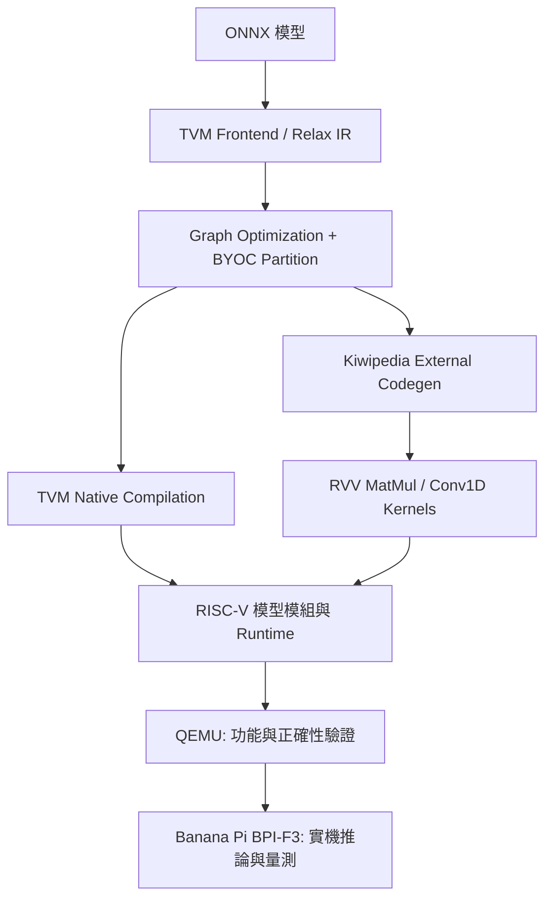

## 1. Project Overview

本專題針對資源有限的 RISC-V 邊緣裝置，研究如何利用 TVM BYOC 將特定算子導向自訂 RVV Kernel，以改善 Transformer 推論效能。研究由 Whisper Decoder 的 Dynamic Shape 與 KV cache 問題出發，逐步延伸至 Generic／Shape-tuned MatMul、Conv1D 矩陣化、15/30 秒 Encoder Shape Bucket、VM 常駐與長音訊分段辨識。最後以 Pythia-70M-deduped 驗證跨模型的 MatMul Kernel 選擇策略。

### 編譯及執行架構



### 主要研究內容

- **Dynamic Shape 支援：** 透過 `RemoveKiwipediaShapeParams` Pass 處理 BYOC 函式多餘的 `R.Shape(...)` 參數，Runtime 改以實際 `DLTensor` 取得 Shape，並修正 MatMul 輸入／輸出的 Tensor 對應。
- **RVV MatMul：** 由三維 Blocking + B Packing 演進為 B 向量在多個輸出列間重用；使用 M 維度 8/4/2/1 列 Kernel、Hybrid LMUL、K-loop unroll 與多核心分配。
- **Whisper Shape tuning：** Encoder 主要關注 `M=1500`（30 秒）與 `M=750`（15 秒）；Decoder 逐 token 的部分運算針對 `M=1` 設計。
- **Conv1D：** 使用 `im2col` 將前端卷積轉為 MatMul，再交由 RVV Kernel 處理。
- **推論流程改善：** 依音訊長度選用 15/30 秒 Encoder；保持 Processor、模型模組及 VM 常駐；對長音訊進行 Chunk 切分、重疊與邊界文字合併。
- **Pythia：** 針對固定 16-token Forward Pass 以 Shape-tuned RVV Kernel 與 GCC Auto-vectorization 建立 Hybrid Dispatcher。**此測試不代表逐 token 生成效能。**

## 2. Results (Reported)

以下為原始專題報告所記載的結果，僅用於說明研究成果。執行時間可能受到模型版本、輸入資料、板子環境與初始化方式影響。

### Whisper-tiny：11 秒 `jfk.flac`

| 版本 | 核心改動 | End-to-end (s) |
| --- | --- | ---: |
| TVM built-in baseline | 未使用本專題 BYOC RVV Kernel | 999.734 |
| O0 | 學長版本 BYOC + RVV MatMul | 92.839 |
| O1 | Decoder Dynamic Shape 修正 | 71.379 |
| O2 | Generic RVV MatMul + Conv1D | 29.118 |
| O3 | 30 秒 Shape-tuned MatMul | 19.126 |
| O4 | 15 秒 Shape Bucket + `M=750` tuning | **12.107** |

O4 相較 TVM built-in baseline 約 **82.57×**。進一步在 O5 採用 VM／Processor 常駐，相同 11 秒音檔第二次推論為 **7.179 秒**（與需初始化的 O4 並非完全相同計時條件）。65 秒長音訊測試為 **50.453 秒，RTF 0.776**。

### Pythia-70M-deduped：固定 16 tokens Forward Pass

| 版本 | 方法 | 平均時間 (s) |
| --- | --- | ---: |
| TVM built-in baseline | Original Scalar | 58.362 |
| O0 | Loop reorder / Shape-aware | 3.555 |
| O1 | GCC Auto-vectorization | 1.149 |
| O2 | Generic Shape RVV | 1.399 |
| O3 | Shape-tuned RVV | 1.144 |
| O4 | Hybrid Dispatcher | **1.100** |

Pythia O4 相較其 baseline 約 **53.05×**。實驗以 20 組 WikiText-103 固定長度輸入測試，**不包含 Tokenizer、KV cache 與自回歸文字生成**。Whisper 與 Pythia 使用各自獨立的 O0–O4 版本編號，請勿混用。

## 3. Quick Start

完整指令、注意事項與疑難排解見 **[建置與編譯指南](docs/BUILD.md)**。

```bash
# 1. 將本文件放進你的 BYOC 專案根目錄；先確認 tvm/ 是「有修改過」的 fork
cd <PROJECT_ROOT>

# 2. 複製並調整個人化路徑（不要提交 env.local.sh）
cp scripts/env.example.sh scripts/env.local.sh
${EDITOR:-nano} scripts/env.local.sh
source scripts/env.local.sh

# 3. 檢查主機端 TVM、交叉編譯器、sysroot 與 QEMU 是否就緒
bash scripts/check_environment.sh

# 4. 建置修改後的 TVM Host Library
cmake -S "$TVM_HOME" -B "$TVM_HOME/build" -DCMAKE_BUILD_TYPE=Release -DUSE_LLVM=ON
cmake --build "$TVM_HOME/build" --parallel "$(nproc)"

# 5. 執行本專題的模型編譯腳本（實際參數／路徑需依原始腳本確認）
python <PATH_TO_COMPILE_ENCODER_PY>
python <PATH_TO_COMPILE_DECODER_PY>
python <PATH_TO_COMPILE_DECODER_WITH_PAST_PY>
```

執行編譯前應先確認 `Encoder / Decoder / Decoder with Past` 各自的 ONNX 輸入、Dynamic Shape 宣告、TVM Target、外部 BYOC Codegen 與 `export_library()` 所用的 RISC-V C++ 編譯器。**上面第 5 步是執行順序範本，不是已驗證的無參數 CLI 契約**；請參閱 [編譯指南](docs/BUILD.md)。

## 4. Repository Structure

```text
tvm-byoc-kiwipedia/
├── README.md
├── .gitignore
├── docs/
│   ├── BUILD.md                  # Ubuntu、環境變數、TVM、交叉編譯、QEMU、實機部署
│   ├── STRUCTURE.md              # 已知原始檔及建議 GitHub 資料夾配置
│   └── PUBLISH.md                # GitHub 公開前的整理與上傳指令
├── scripts/
│   ├── env.example.sh            # 可複製的環境設定範本
│   └── check_environment.sh      # 環境檢查工具
├── tvm/                          # 待加入：本專題修改的 TVM BYOC fork
├── models/                       # 待加入：Whisper / Pythia ONNX 與設定
├── benchmarks/                   # 待加入：Kernel Benchmark 原始程式與數據
└── artifacts/                    # 本機生成：模型 .so、紀錄等（預設不提交）
```

**注意：** 這是**推薦公開結構**，不是從上傳報告中還原的實際 Git tree。既有程式碼不必強制移動；請依 [檔案對照與定位方式](docs/STRUCTURE.md) 確認實際相對路徑。

## 5. Documentation

- [BUILD.md — 環境建置、編譯流程、QEMU 與 Banana Pi 部署](docs/BUILD.md)
- [STRUCTURE.md — 檔案與模組職責、路徑確認方法](docs/STRUCTURE.md)
- [PUBLISH.md — 將文件整合到既有 GitHub 儲存庫](docs/PUBLISH.md)
- [env.example.sh — Host 環境變數設定](scripts/env.example.sh)
- [check_environment.sh — 環境檢查工具](scripts/check_environment.sh)

## 6. Notes for Reproducibility

1. 本專題使用的 TVM **含有自訂 Relax Pass、Kiwipedia Codegen、Runtime 與 RVV Kernel**，需公開該 fork 的 commit 或 patch；官方原版 TVM 不會自動提供這些功能。
2. 建議補充 `git submodule status`、`riscv64-unknown-linux-gnu-g++ --version`、`qemu-riscv64 --version`、`python --version`、Banana Pi 作業系統與 RVV 支援資訊。
3. RVV 交叉編譯旗標 `-march=rv64gcv -mabi=lp64d` 為先前測試範例；實際旗標必須與**目標處理器、ABI、交叉工具鏈及 sysroot** 相容。
4. QEMU 用來驗證可執行性與正確性，**不將 QEMU 的執行秒數視為 Banana Pi 實機效能**。
5. 報告說明研究方法與成果，**未列出各編譯腳本完整參數、程式依賴版本及原始 Git commit**；這些需由公開原始碼與環境鎖定檔補足。

## 7. Credits & References

專題研究：國立中正大學；指導教授：陳鵬升。  
研究成員：林垣邑、吳昱緯、劉韋佺。

依據：專題報告 *Accelerating LLM Inference with RISC-V Vector Extensions through TVM BYOC*。主要技術參考包含 [Apache TVM](https://tvm.apache.org/)、[OpenAI Whisper](https://github.com/openai/whisper)、[whisper.cpp](https://github.com/ggml-org/whisper.cpp)、[Pythia](https://github.com/EleutherAI/pythia) 與 RISC-V Vector Extension。

> **License：** 公開原始碼前，請先確認學長既有程式、TVM fork、模型權重及第三方依賴的授權條件；本文件範本不代替任何原始專案的授權聲明。
