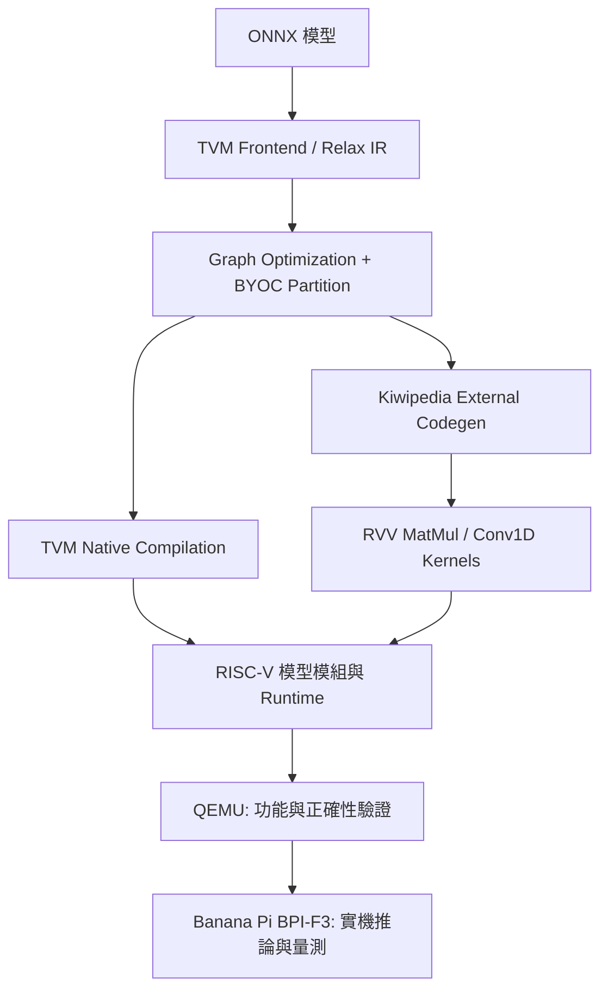

# Accelerating Transformer Inference with RISC-V Vector Extensions through TVM BYOC

> 使用 TVM Bring Your Own Codegen（BYOC）將 Transformer 模型的關鍵運算交由 RISC-V Vector Extension（RVV）Kernel 執行，並於 Banana Pi BPI-F3 驗證模型推論及效能。

**研究模型：** Whisper-tiny（Encoder–Decoder 語音辨識）與 Pythia-70M-deduped（Decoder-only Transformer）  
**模型格式：** ONNX  
**編譯主機：** x86 Ubuntu  
**部署平台：** Banana Pi BPI-F3（SpacemiT K1、RISC-V、RVV）  
**核心技術：** TVM Relax / BYOC、Kiwipedia Codegen、RVV MatMul、Conv1D、Dynamic Shape、Shape-tuned Kernel
**TVM 版本：** Apache TVM v0.22.0（Custom Kiwipedia BYOC）

## 1. Project Overview

專題針對資源有限的 RISC-V 邊緣裝置，研究如何利用 TVM BYOC 將特定算子導向自訂 RVV Kernel，以改善 Transformer 推論效能。研究由 Whisper Decoder 的 Dynamic Shape 與 KV cache 問題出發，逐步延伸至 Generic／Shape-tuned MatMul、Conv1D 矩陣化、15/30 秒 Encoder Shape Bucket、VM 常駐與長音訊分段辨識。最後以 Pythia-70M-deduped 驗證跨模型的 MatMul Kernel 選擇策略。

### 編譯及執行架構

### 主要研究內容

- **Dynamic Shape 支援：** 透過 `RemoveKiwipediaShapeParams` Pass 處理 BYOC 函式多餘的 `R.Shape(...)` 參數，Runtime 改以實際 `DLTensor` 取得 Shape，並修正 MatMul 輸入／輸出的 Tensor 對應。
- **RVV MatMul：** 由三維 Blocking + B Packing 演進為 B 向量在多個輸出列間重用；使用 M 維度 8/4/2/1 列 Kernel、Hybrid LMUL、K-loop unroll 與多核心分配。
- **Whisper Shape tuning：** Encoder 主要關注 `M=1500`（30 秒）與 `M=750`（15 秒）；Decoder 逐 token 的部分運算針對 `M=1` 設計。
- **Conv1D：** 使用 `im2col` 將前端卷積轉為 MatMul，再交由 RVV Kernel 處理。
- **推論流程改善：** 依音訊長度選用 15/30 秒 Encoder；保持 Processor、模型模組及 VM 常駐；對長音訊進行 Chunk 切分、重疊與邊界文字合併。
- **Pythia：** 針對固定 16-token Forward Pass 以 Shape-tuned RVV Kernel 與 GCC Auto-vectorization 建立 Hybrid Dispatcher。**此測試不代表逐 token 生成效能。**

## 2. Results

以下為原始專題報告所記載的結果，僅用於說明研究成果。執行時間可能受到模型版本、輸入資料、板子環境與初始化方式影響。

### Whisper-tiny：11 秒

| 版本 | 核心改動 | End-to-end (s) |
| --- | --- | ---: |
| TVM built-in baseline | 未使用本專題 BYOC RVV Kernel | 999.734 |
| O0 | 學長版本 BYOC + RVV MatMul | 92.839 |
| O1 | Decoder Dynamic Shape 修正 | 71.379 |
| O2 | Generic RVV MatMul + Conv1D | 29.118 |
| O3 | 30 秒 Shape-tuned MatMul | 19.126 |
| O4 | 15 秒 Shape Bucket + `M=750` tuning | **12.107** |

O4 相較 TVM built-in baseline 約 **82.57×**。進一步在 O5 採用 VM／Processor 常駐，相同 11 秒音檔第二次推論為 **7.179 秒**（與需初始化的 O4 並非完全相同計時條件）。65 秒長音訊測試為 **50.453 秒，RTF 0.776**。

### Pythia-70M-deduped：固定 16 tokens Forward Pass

| 版本 | 方法 | 平均時間 (s) |
| --- | --- | ---: |
| TVM built-in baseline | Original Scalar | 58.362 |
| O0 | Loop reorder / Shape-aware | 3.555 |
| O1 | GCC Auto-vectorization | 1.149 |
| O2 | Generic Shape RVV | 1.399 |
| O3 | Shape-tuned RVV | 1.144 |
| O4 | Hybrid Dispatcher | **1.100** |

Pythia O4 相較其 baseline 約 **53.05×**。實驗以 20 組 WikiText-103 固定長度輸入測試，**不包含 Tokenizer、KV cache 與自回歸文字生成**。Whisper 與 Pythia 使用各自獨立的 O0–O4 版本編號，請勿混用。

## 3.Start：Ubuntu → RISC-V Cross Compilation → Banana Pi BPI-F3

### 三階段安裝地圖

| 階段 | 執行設備 | 建置內容 | 詳細教學 |
| --- | --- | --- | --- |
| **Phase 1** | x86 Ubuntu | 工具、Python、Git LFS、ONNX、TVM (Kiwipedia) 和 Host 環境變數 | [compile_tvm.md](compile_tvm.md) |
| **Phase 2A** | x86 Ubuntu | RISC-V GNU Linux Toolchain、sysroot、QEMU 正確性驗證 | [compile_riscv_toolchain.md](compile_riscv_toolchain.md) |
| **Phase 2B** | x86 Ubuntu | Kiwipedia Runtime／Codegen、目標 LLVM triple、`fcompile`、三個 RISC-V `.so` | [set_up_bananapi_runtime_and_codegen.md](set_up_bananapi_runtime_and_codegen.md) |
| **Phase 3** | Banana Pi BPI-F3 | `rsync`、板端 TVM Runtime、RVV MatMul `.so`、Processor、音訊推論 ||

### 常見問題（Troubleshooting）

| 錯誤／症狀 | 建議處理 |
| --- | --- |
| `onnx.onnx_cpp2py_export.checker.ValidationError`、`DecodeError` | 確認 ONNX 不是 Git LFS pointer：回專案根目錄執行 `git lfs pull`，檢查 `git lfs ls-files` |
| `ModuleNotFoundError: tvm` | 確認已啟動 `.venv`，`source env_tvm.sh`，並執行 `python -c 'import tvm; print(tvm.__file__)'` |
| `cannot import ... core`、`tvm_ffi` 匯入失敗 | 在**同一個 venv** 執行 `python -m pip install -e ./tvm/3rdparty/tvm-ffi`；排查舊路徑／版本衝突 |
| `runtime.kiwipedia_runtime_create` 為 `None` | Kiwipedia Runtime 未正確建置／註冊；檢查 TVM 編譯選項與原始碼，不要直接進入 inference |
| `Failed to load symbol 'matmul'`、`dlopen` 失敗 | 檢查 `$KIWIPEDIA_MATMUL_SO`、`file libmatmul.so`；回第 4 步重新用 x86 `g++` 編譯 |
| `No such file or directory: 'audio.wav'` | 必須在 `whisper-tiny/` 目錄執行、準備 `audio.wav` 並以 `ffprobe` 檢查 |
| `WhisperProcessor`／Pillow 匯入失敗 | `python -m pip install -U pillow transformers sentencepiece`；如有 API 差異，需固定相容版本 |
| 出現 `/home/lewis56/...` 舊路徑 | 優先設定 `KIWIPEDIA_MATMUL_SO`；用 `grep -RIn --exclude-dir=build '/home/lewis56' tvm/src whisper-tiny` 找出需要人工修改的內容 |
| CMake 編譯記憶體不足 | 將 `cmake --build build --parallel "$(nproc)"` 改為 `--parallel 2` 或 `--parallel 4` |
| 顯示 warning 但 `.so` 未生成 | 不可當作成功；確認編譯程式最後的錯誤訊息、模型依賴及目標編譯器 |

