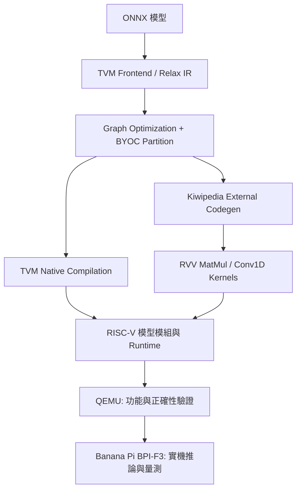

# Accelerating Transformer Inference with RISC-V Vector Extensions through TVM BYOC

> 使用 TVM Bring Your Own Codegen（BYOC）將 Transformer 模型的關鍵運算交由 RISC-V Vector Extension（RVV）Kernel 執行，並於 Banana Pi BPI-F3 驗證模型推論及效能。

**研究模型：** Whisper-tiny（Encoder–Decoder 語音辨識）與 Pythia-70M-deduped（Decoder-only Transformer）  
**模型格式：** ONNX  
**編譯主機：** x86 Ubuntu  
**部署平台：** Banana Pi BPI-F3（SpacemiT K1、RISC-V、RVV）  
**核心技術：** TVM Relax / BYOC、Kiwipedia Codegen、RVV MatMul、Conv1D、Dynamic Shape、Shape-tuned Kernel

> [!IMPORTANT]
> 此資料夾提供**根據專題報告與既有開發紀錄整理的公開文件範本**，不包含 TVM 修改原始碼、模型 ONNX 檔與已編譯 `.so`。完整重現前，須將實際使用的 TVM fork、Python 編譯腳本及模型檔案補入；所有帶有 `<...>` 的位置均須自行替換。**不要以未修改的官方 TVM 直接替代本專題的 BYOC fork。**

## 1. Project Overview

本專題針對資源有限的 RISC-V 邊緣裝置，研究如何利用 TVM BYOC 將特定算子導向自訂 RVV Kernel，以改善 Transformer 推論效能。研究由 Whisper Decoder 的 Dynamic Shape 與 KV cache 問題出發，逐步延伸至 Generic／Shape-tuned MatMul、Conv1D 矩陣化、15/30 秒 Encoder Shape Bucket、VM 常駐與長音訊分段辨識。最後以 Pythia-70M-deduped 驗證跨模型的 MatMul Kernel 選擇策略。

### 編譯及執行架構



### 主要研究內容

- **Dynamic Shape 支援：** 透過 `RemoveKiwipediaShapeParams` Pass 處理 BYOC 函式多餘的 `R.Shape(...)` 參數，Runtime 改以實際 `DLTensor` 取得 Shape，並修正 MatMul 輸入／輸出的 Tensor 對應。
- **RVV MatMul：** 由三維 Blocking + B Packing 演進為 B 向量在多個輸出列間重用；使用 M 維度 8/4/2/1 列 Kernel、Hybrid LMUL、K-loop unroll 與多核心分配。
- **Whisper Shape tuning：** Encoder 主要關注 `M=1500`（30 秒）與 `M=750`（15 秒）；Decoder 逐 token 的部分運算針對 `M=1` 設計。
- **Conv1D：** 使用 `im2col` 將前端卷積轉為 MatMul，再交由 RVV Kernel 處理。
- **推論流程改善：** 依音訊長度選用 15/30 秒 Encoder；保持 Processor、模型模組及 VM 常駐；對長音訊進行 Chunk 切分、重疊與邊界文字合併。
- **Pythia：** 針對固定 16-token Forward Pass 以 Shape-tuned RVV Kernel 與 GCC Auto-vectorization 建立 Hybrid Dispatcher。**此測試不代表逐 token 生成效能。**

## 2. Results (Reported)

以下為原始專題報告所記載的結果，僅用於說明研究成果。執行時間可能受到模型版本、輸入資料、板子環境與初始化方式影響。

### Whisper-tiny：11 秒 `jfk.flac`

| 版本 | 核心改動 | End-to-end (s) |
| --- | --- | ---: |
| TVM built-in baseline | 未使用本專題 BYOC RVV Kernel | 999.734 |
| O0 | 學長版本 BYOC + RVV MatMul | 92.839 |
| O1 | Decoder Dynamic Shape 修正 | 71.379 |
| O2 | Generic RVV MatMul + Conv1D | 29.118 |
| O3 | 30 秒 Shape-tuned MatMul | 19.126 |
| O4 | 15 秒 Shape Bucket + `M=750` tuning | **12.107** |

O4 相較 TVM built-in baseline 約 **82.57×**。進一步在 O5 採用 VM／Processor 常駐，相同 11 秒音檔第二次推論為 **7.179 秒**（與需初始化的 O4 並非完全相同計時條件）。65 秒長音訊測試為 **50.453 秒，RTF 0.776**。

### Pythia-70M-deduped：固定 16 tokens Forward Pass

| 版本 | 方法 | 平均時間 (s) |
| --- | --- | ---: |
| TVM built-in baseline | Original Scalar | 58.362 |
| O0 | Loop reorder / Shape-aware | 3.555 |
| O1 | GCC Auto-vectorization | 1.149 |
| O2 | Generic Shape RVV | 1.399 |
| O3 | Shape-tuned RVV | 1.144 |
| O4 | Hybrid Dispatcher | **1.100** |

Pythia O4 相較其 baseline 約 **53.05×**。實驗以 20 組 WikiText-103 固定長度輸入測試，**不包含 Tokenizer、KV cache 與自回歸文字生成**。Whisper 與 Pythia 使用各自獨立的 O0–O4 版本編號，請勿混用。

## 3. Quick Start：Ubuntu → RISC-V Cross Compilation → Banana Pi BPI-F3

本專案提供兩條清楚區分的路線：**Track A 在 x86 Ubuntu 上編譯與執行已公開的 Kiwipedia 範例**；**Track B 將有對應 RVV／Dynamic Shape 實作的版本交叉編譯並部署到 Banana Pi**。新手建議先完成 Track A，再操作 Track B；不能直接把 Track A 產生的 x86 `.so` 傳到板端。

### 三階段安裝地圖

| 階段 | 執行設備 | 建置內容 | 詳細教學 |
| --- | --- | --- | --- |
| **Phase 1** | VirtualBox / x86 Ubuntu | 工具、Python、Git LFS、ONNX、TVM (Kiwipedia) 和 Host 環境變數 | [compile_tvm.md](docs/compile_tvm.md) |
| **Phase 2A** | x86 Ubuntu | RISC-V GNU Linux Toolchain、sysroot、QEMU 正確性驗證 | [compile_riscv_toolchain.md](docs/compile_riscv_toolchain.md) |
| **Phase 2B** | x86 Ubuntu | Kiwipedia Runtime／Codegen、目標 LLVM triple、`fcompile`、三個 RISC-V `.so` | [set_up_bananapi_runtime_and_codegen.md](docs/set_up_bananapi_runtime_and_codegen.md) |
| **Phase 3** | Banana Pi BPI-F3 | `rsync`、板端 TVM Runtime、RVV MatMul `.so`、Processor、音訊推論 | [banana_pi_deployment.md](docs/banana_pi_deployment.md) |

**參考來源：** [930727fre/tvm_rvv_matmul_byoc](https://github.com/930727fre/tvm_rvv_matmul_byoc) 的 TVM v0.20.0 + `bananapi` BYOC 部署範例；本專題使用 `kiwipedia` backend，請先閱讀 [兩個版本與檔案名稱差異](docs/REFERENCE_COMPARISON.md)。這份參考來源不是本專題後期 O4/O5 最終程式的直接替代品。

### Track A — 先在 Ubuntu Host 跑通公開版

本節以已公開的 [`lewis21456/tvm-byoc-kiwipedia`](https://github.com/lewis21456/tvm-byoc-kiwipedia) 為基礎，提供 **x86_64 Ubuntu 主機端**的完整操作流程。新手可依序執行 **0 → 10**，不用先安裝 RISC-V 交叉編譯器。

> [!IMPORTANT]
> **先分清楚兩種流程：** 這份公開版的 `whisper-tiny/onnx/compile_*.py` 目前使用 `target="llvm"`，輸出的是 **x86 Host** 模型 `.so`。其 `libmatmul.cpp` 也是一般 C++ MatMul。這一節的目標是「在 Ubuntu 跑通公開版本」；**不是**宣稱已重現研究報告中 Banana Pi BPI-F3 的 RVV Shape-tuned 結果。報告的 RISC-V/RVV 交叉編譯、板端執行與 QEMU 測試，另見 [BUILD.md](docs/BUILD.md)。公開版 `compile_decoder_with_past.py` 的 Kiwipedia BYOC `RunCodegen()` 目前為註解，請勿直接將此版等同報告中的完整 Decoder BYOC 最終版本。
>
> **範例環境：** Ubuntu x86_64、可使用 `sudo` 的使用者、Python 3、可連接 GitHub／Python 套件來源。由於原專案尚未提供鎖定版本的完整環境檔，不同日期安裝最新版套件可能需要調整相容版本。

### 0. 安裝系統工具（Ubuntu）

開啟終端機，依序安裝 Git、Git LFS、C/C++ 編譯器、CMake、LLVM／Clang、Python、音訊工具：

```bash
sudo apt update
sudo apt install -y \
  git git-lfs build-essential cmake ninja-build \
  llvm llvm-dev clang pkg-config file binutils \
  python3 python3-pip python3-venv \
  ffmpeg libsndfile1 libtinfo-dev zlib1g-dev

git lfs install

# 確認工具已安裝
git --version
git lfs version
cmake --version
llvm-config --version
python3 --version
```

`git-lfs` **不可省略**：模型 `.onnx` 可能由 Git LFS 管理，如果只下載到文字指標檔，後續 `onnx.load()` 會無法解碼。

### 1. Clone 原始專案並下載模型（Git LFS）

```bash
cd "$HOME"
git clone https://github.com/lewis21456/tvm-byoc-kiwipedia.git
cd tvm-byoc-kiwipedia

# 下載 TVM 內含的子模組（若有）
git submodule update --init --recursive

# 下載 LFS 管理的模型檔案
git lfs pull

# 紀錄程式版本，方便重現
git rev-parse --short HEAD
```

預期會使用下列路徑：

```text
tvm-byoc-kiwipedia/
├── tvm/                              # 本專案修改的 TVM 原始碼
│   └── src/runtime/contrib/kiwipedia/
│       ├── kiwipedia_runtime.cc      # Kiwipedia Runtime / dlopen
│       └── libmatmul.cpp             # 本節編譯的 x86 MatMul
└── whisper-tiny/
    ├── inference.py                  # 執行語音辨識
    ├── audio.wav                     # 第 8 步準備
    ├── [Processor / Tokenizer 檔案]
    └── onnx/
        ├── encoder_model.onnx
        ├── decoder_model.onnx
        ├── decoder_with_past_model.onnx
        ├── compile_encoder.py
        ├── compile_decoder.py
        └── compile_decoder_with_past.py
```

先確認三個 ONNX 都是有效模型、不是 Git LFS pointer：

```bash
cd "$HOME/tvm-byoc-kiwipedia"

for name in encoder_model decoder_model decoder_with_past_model; do
  model="whisper-tiny/onnx/${name}.onnx"
  test -s "$model" || { echo "找不到模型：$model"; exit 1; }
  if head -c 80 "$model" | grep -aq 'git-lfs.github.com/spec/v1'; then
    echo "仍為 Git LFS 指標檔：$model"
    exit 1
  fi
  ls -lh "$model"
done
```

如果遇到 LFS 指標檔，請在專案根目錄重新執行 `git lfs pull`。如果仍缺檔，使用 `git lfs ls-files` 確認它是否真的由該版本的 Git LFS 追蹤。**單獨下載 Hugging Face 的原生 PyTorch 模型，不能直接取代這三個特定介面的 ONNX 模型**；需要使用專案相容的 ONNX 匯出方式。

### 2. 建立 Python 虛擬環境、安裝套件

建議使用 `.venv`，避免修改系統 Python、與過去安裝的 TVM／`tvm_ffi` 混用。

```bash
cd "$HOME/tvm-byoc-kiwipedia"
python3 -m venv .venv
source .venv/bin/activate

python -m pip install --upgrade pip setuptools wheel
python -m pip install \
  numpy scipy onnx transformers sentencepiece \
  soundfile librosa yt-dlp \
  ninja psutil cython pillow \
  scikit-build-core pybind11 packaging

# 確認目前 Python 來自 .venv
which python
python -m pip --version
```

> `torch` 是選用套件：若模型轉換工具或特定 `transformers` 版本要求，再於相同 `.venv` 執行 `python -m pip install torch`。不必為了使用已存在的 ONNX 檔，額外重新下載 Whisper 原生權重。

### 3. 編譯修改後的 TVM（LLVM + Kiwipedia）

**一定使用 Clone 下來的 `tvm/`**；官方未修改的 TVM 版本不一定包含 Kiwipedia Codegen／Runtime。

```bash
cd "$HOME/tvm-byoc-kiwipedia/tvm"

# 第一次建置，或確定要重新建置時使用
rm -rf build
mkdir -p build

# 啟用 LLVM 與本專案的 Kiwipedia 選項
cmake -S . -B build \
  -DCMAKE_BUILD_TYPE=Release \
  -DUSE_LLVM=ON \
  -DUSE_KIWIPEDIA_CODEGEN=ON \
  -DUSE_KIWIPEDIA_RUNTIME=ON

cmake --build build --parallel "$(nproc)"

# 檢查 Host TVM shared library
ls -lh build/libtvm.so
```

`USE_KIWIPEDIA_CODEGEN` / `USE_KIWIPEDIA_RUNTIME` 是專案先前建置時使用的 CMake 設定。**若 CMake 顯示 `Manually-specified variables were not used`，代表該版 build system 可能未使用這些變數，不能只憑 CMake 成功就認定 BYOC 已啟用。**請以第 6 步的註冊函式檢查為準。若重建時間較長，可將 `--parallel "$(nproc)"` 改為 `--parallel 4` 降低記憶體壓力。

### 4. 編譯 Kiwipedia MatMul 外部函式庫

此步使用 **x86 主機的 `g++`**，產生 `libmatmul.so`，供目前公開版 Kiwipedia Runtime 透過 `dlopen()` 動態載入。

```bash
cd "$HOME/tvm-byoc-kiwipedia/tvm/src/runtime/contrib/kiwipedia"

# 若此 include 位置不存在，先檢查第三方 DLPack 子模組是否完整
test -f "$HOME/tvm-byoc-kiwipedia/tvm/3rdparty/tvm-ffi/3rdparty/dlpack/include/dlpack/dlpack.h"

g++ -O3 -shared -fPIC libmatmul.cpp \
  -I"$HOME/tvm-byoc-kiwipedia/tvm/3rdparty/tvm-ffi/3rdparty/dlpack/include" \
  -o libmatmul.so

file libmatmul.so
```

看到 `ELF ... x86-64 ... shared object` 是**本節正常結果**。它不是 RISC-V 向量化的 MatMul；使用 `riscv64-unknown-linux-gnu-g++` 產生的 RISC-V `.so` 不能由 x86 Python 程序直接載入。

### 5. 安裝 TVM FFI（在同一個虛擬環境）

```bash
cd "$HOME/tvm-byoc-kiwipedia"
source .venv/bin/activate

python -m pip install -e ./tvm/3rdparty/tvm-ffi

# 基本檢查
python -c "import tvm_ffi; print('tvm_ffi: OK')"
```

過去遇到的 `cannot import ... core` 常與 `tvm_ffi` 未安裝、舊版本混用或 `PYTHONPATH` 指向其他 TVM 有關。若仍出錯，先確認 `which python` 與 `python -m pip show tvm-ffi`，**只在當前 `.venv` 內**執行必要的移除／重裝，不要刪除整個系統 site-packages 的 `.pth` 檔。

### 6. 設定環境變數並驗證 TVM

**只要 Clone 原始專案就可以使用以下方式**，直接建立自己的 `env_tvm.sh`（不依賴額外下載的文件包）：

```bash
cd "$HOME/tvm-byoc-kiwipedia"
cat > env_tvm.sh <<'ENV'
#!/usr/bin/env bash
export PROJECT_ROOT="$HOME/tvm-byoc-kiwipedia"
export TVM_HOME="$PROJECT_ROOT/tvm"
export PYTHONPATH="$TVM_HOME/python:$TVM_HOME/3rdparty/tvm-ffi/python${PYTHONPATH:+:$PYTHONPATH}"
export LD_LIBRARY_PATH="$TVM_HOME/build:$TVM_HOME/build/lib${LD_LIBRARY_PATH:+:$LD_LIBRARY_PATH}"
export KIWIPEDIA_MATMUL_SO="$TVM_HOME/src/runtime/contrib/kiwipedia/libmatmul.so"
export PATH="$HOME/.local/bin:$PATH"
ENV

source env_tvm.sh

# 驗證設定內容
printf 'PROJECT_ROOT=%s\n' "$PROJECT_ROOT"
printf 'TVM_HOME=%s\n' "$TVM_HOME"
printf 'KIWIPEDIA_MATMUL_SO=%s\n' "$KIWIPEDIA_MATMUL_SO"
```

如果你**已把本文件包的 `scripts/` 複製到原始專案**，也可以改用 `cp scripts/env.example.sh scripts/env.local.sh` 與 `source scripts/env.local.sh`，其中的路徑設計較適合在不同使用者目錄下重用。

| 環境變數 | 功能 |
| --- | --- |
| `PROJECT_ROOT` | 指向整個 `tvm-byoc-kiwipedia/` 專案 |
| `TVM_HOME` | 指向這份修改過的 `tvm/` |
| `PYTHONPATH` | 使用本專案的 TVM Python package 與 TVM FFI |
| `LD_LIBRARY_PATH` | 在 x86 Host 找到編譯好的 `libtvm.so` |
| `KIWIPEDIA_MATMUL_SO` | Runtime 用 `getenv()` 取得外部 MatMul `.so` 絕對路徑 |
| `PATH` | 讓終端機找到使用者安裝的命令列程式 |

變數只在當前 terminal session 生效；每次新開終端機，要重新 `source .venv/bin/activate` 與 `source env_tvm.sh`（或 `source scripts/env.local.sh`）。**不要把自己電腦的 `env_tvm.sh` 提交到 GitHub**；本文件包的 `.gitignore` 已將其排除。

執行下列驗證命令：

```bash
python -c "import tvm; print('TVM:', tvm.__file__)"
python -c "import tvm; print('LLVM:', tvm.get_global_func('target.build.llvm', True))"
python -c "import tvm; print('Kiwipedia Runtime:', tvm.get_global_func('runtime.kiwipedia_runtime_create', True))"
ls -lh "$KIWIPEDIA_MATMUL_SO"

# 已複製本文件包 scripts/ 時，亦可執行
bash scripts/check_host.sh
```

**後兩個 `get_global_func(...)` 均不可顯示 `None`。** `LLVM` 及 `Kiwipedia Runtime` 皆有註冊，才進入模型編譯。這是必要條件，還不是完整推論成功的保證。

### 7. 編譯 Whisper-tiny 的三個 ONNX 模型

這三個模型在公開版的編譯腳本中，使用 `target="llvm"`，並透過 `export_library()` 產生同名 `.so`。

```bash
cd "$HOME/tvm-byoc-kiwipedia/whisper-tiny/onnx"

python compile_encoder.py
python compile_decoder.py
python compile_decoder_with_past.py

# 三個輸出檔案應存在
ls -lh encoder_model.so decoder_model.so decoder_with_past_model.so
file encoder_model.so decoder_model.so decoder_with_past_model.so
```

| 編譯腳本 | 輸入 ONNX | 輸出 `.so` | 作用 |
| --- | --- | --- | --- |
| `compile_encoder.py` | `encoder_model.onnx` | `encoder_model.so` | Mel 特徵 → Encoder 輸出 |
| `compile_decoder.py` | `decoder_model.onnx` | `decoder_model.so` | Decoder Prefill |
| `compile_decoder_with_past.py` | `decoder_with_past_model.onnx` | `decoder_with_past_model.so` | 逐 token 解碼與 KV cache |

此公開版本的 Encoder Shape 是 `(1, 80, 3000)`，Decoder 使用長度 1500 的 Encoder 特徵。**報告提到的 15 秒 Shape Bucket、M=750 Kernel 與最終 RVV BYOC 程式碼，不能直接假設已包含於這三支公開腳本。**

正常情況可能會出現非致命的 warning；**若有 Python traceback、CMake error 或 `.so` 未產生，就不能視為成功。**

### 8. 準備 Whisper 音訊與 Processor／Tokenizer

公開版 `whisper-tiny/inference.py` 使用以下**相對路徑**：

- `WhisperProcessor.from_pretrained("./")` 與 `WhisperTokenizer.from_pretrained("./")`
- `sf.read("audio.wav")`
- `./onnx/encoder_model.so`、`decoder_model.so`、`decoder_with_past_model.so`

所以要**在 `whisper-tiny/` 目錄啟動**，並確認該目錄有對應的 Processor／Tokenizer 設定檔；缺少時需取得與 ONNX 對應的相同 Whisper 模型設定，不能任意混用其他版本。

若缺少設定檔，可在 **Host** 執行（只取 `.json`、`.txt`、`.model`，不覆蓋既有 ONNX）：

```bash
cd "$HOME/tvm-byoc-kiwipedia"
source .venv/bin/activate
python -m pip install huggingface_hub
python - <<'PYCODE'
from huggingface_hub import snapshot_download
snapshot_download(
    repo_id="onnx-community/whisper-tiny",
    local_dir="whisper-tiny",
    allow_patterns=["*.json", "*.txt", "*.model"],
)
PYCODE
```

這些設定檔是否完整、與三個 ONNX 是否相容，仍須以 `WhisperProcessor.from_pretrained()` 與實際推論測試確認。

```bash
cd "$HOME/tvm-byoc-kiwipedia/whisper-tiny"
ls -lh onnx/*_model.so
ls -1 preprocessor_config.json tokenizer_config.json 2>/dev/null || true
```

最穩定的音訊準備方式是**使用自己有權使用的音訊檔**：

```bash
# 把 /path/to/your_audio.wav 換成實際音訊路徑
ffmpeg -y -i /path/to/your_audio.wav -ac 1 -ar 16000 -c:a pcm_s16le audio.wav

file audio.wav
ffprobe -v error -show_entries format=duration -of default=nw=1 audio.wav
```

也可以沿用團隊先前使用的 yt-dlp 測試指令（需網路、影音來源可存取且有下載使用權）：

```bash
python -m yt_dlp --extract-audio --audio-format wav \
  --download-sections '*00:00:00-00:00:20' \
  -o 'audio.%(ext)s' \
  'https://youtu.be/7NdSnwDkPYs'

# 下載產物名稱可能依來源及 yt-dlp 行為不同；先確認檔名
ls -lh audio*.wav
# 若已有 audio.wav，就不用重新命名
```

> 本公開版的 Encoder 為固定 30 秒輸入，建議初次測試使用 **不超過 30 秒** 的音訊；它與報告後期的長音訊 Chunk 系統不同。

### 9. 執行 Whisper 推論

```bash
cd "$HOME/tvm-byoc-kiwipedia"
source .venv/bin/activate
source env_tvm.sh              # 或使用 scripts/env.local.sh

cd whisper-tiny
python inference.py
```

成功時可看到 Encoder、Decoder Prefill、Token Generation 的計時資訊，最後會顯示 `Transcription:` 與文字辨識結果。推論使用的 MatMul 外部函式庫路徑由 `$KIWIPEDIA_MATMUL_SO` 指定，且須與執行 Python 的 **x86 架構相同**。

### 10. 日後再次執行（不用重編 TVM）

```bash
cd "$HOME/tvm-byoc-kiwipedia"
source .venv/bin/activate
source env_tvm.sh
cd whisper-tiny
python inference.py
```

只有在修改 TVM、`libmatmul.cpp`、編譯腳本／模型，或更換系統函式庫後，才需要回到相應的編譯步驟。只換 `audio.wav` 時，正常不需要重新編譯模型。

### 常見問題（Troubleshooting）

| 錯誤／症狀 | 建議處理 |
| --- | --- |
| `onnx.onnx_cpp2py_export.checker.ValidationError`、`DecodeError` | 確認 ONNX 不是 Git LFS pointer：回專案根目錄執行 `git lfs pull`，檢查 `git lfs ls-files` |
| `ModuleNotFoundError: tvm` | 確認已啟動 `.venv`，`source env_tvm.sh`，並執行 `python -c 'import tvm; print(tvm.__file__)'` |
| `cannot import ... core`、`tvm_ffi` 匯入失敗 | 在**同一個 venv** 執行 `python -m pip install -e ./tvm/3rdparty/tvm-ffi`；排查舊路徑／版本衝突 |
| `runtime.kiwipedia_runtime_create` 為 `None` | Kiwipedia Runtime 未正確建置／註冊；檢查 TVM 編譯選項與原始碼，不要直接進入 inference |
| `Failed to load symbol 'matmul'`、`dlopen` 失敗 | 檢查 `$KIWIPEDIA_MATMUL_SO`、`file libmatmul.so`；回第 4 步重新用 x86 `g++` 編譯 |
| `No such file or directory: 'audio.wav'` | 必須在 `whisper-tiny/` 目錄執行、準備 `audio.wav` 並以 `ffprobe` 檢查 |
| `WhisperProcessor`／Pillow 匯入失敗 | `python -m pip install -U pillow transformers sentencepiece`；如有 API 差異，需固定相容版本 |
| 出現 `/home/lewis56/...` 舊路徑 | 優先設定 `KIWIPEDIA_MATMUL_SO`；用 `grep -RIn --exclude-dir=build '/home/lewis56' tvm/src whisper-tiny` 找出需要人工修改的內容 |
| CMake 編譯記憶體不足 | 將 `cmake --build build --parallel "$(nproc)"` 改為 `--parallel 2` 或 `--parallel 4` |
| 顯示 warning 但 `.so` 未生成 | 不可當作成功；確認編譯程式最後的錯誤訊息、模型依賴及目標編譯器 |

> [!WARNING]
> **不要對整個 repo 執行無差別的 `sed -i` 取代絕對路徑，也不要刪除所有 site-packages 的 `.pth`。** 這些操作可能損壞第三方原始碼與 Python 環境。原公開版 Kiwipedia Runtime 已支援 `KIWIPEDIA_MATMUL_SO`，通常只要設定正確的絕對路徑即可。

### Track B — 從 RISC-V 工具鏈到 Banana Pi RVV 推論

**以下是在 x86 Host 編譯、RISC-V Target 執行的實際操作順序**；標有「需移植」的部分必須先有相容的 Kiwipedia／Dynamic Shape 原始碼，不保證僅複製命令即可成功。

**B1. 在 Ubuntu 安裝 RISC-V Linux GNU Toolchain**：依 [compile_riscv_toolchain.md](docs/compile_riscv_toolchain.md) 完成 `make linux`，並確認：

```bash
export RISCV_TOOLCHAIN_ROOT="$HOME/opt/riscv"
export PATH="$RISCV_TOOLCHAIN_ROOT/bin:$PATH"
export RISCV_CXX="$RISCV_TOOLCHAIN_ROOT/bin/riscv64-unknown-linux-gnu-g++"
export RISCV_SYSROOT="$("$RISCV_CXX" -print-sysroot)"
"$RISCV_CXX" --version
```

**B2. 調整 Kiwipedia 模型編譯腳本（需移植）**：參考版使用 LLVM target triple `riscv64-unknown-linux-gnu`、`-march=rv64gcv -mabi=lp64d` 及 `ex.export_library(..., fcompile=riscv_fcompile)`。必須核對本專題 `RunCodegen()`、`RemoveKiwipediaShapeParams`、Runtime API，而非單純替換 `target`。詳見 [Codegen／Runtime 修改與 RISC-V 編譯](docs/set_up_bananapi_runtime_and_codegen.md)。

```bash
# 在 x86 Ubuntu Host；以下三行僅於腳本已完成 RISC-V 適配後執行
cd "$HOME/tvm-byoc-kiwipedia/whisper-tiny/onnx"
python compile_encoder.py
python compile_decoder.py
python compile_decoder_with_past.py

file encoder_model.so decoder_model.so decoder_with_past_model.so
readelf -h encoder_model.so | grep 'Machine:'
```

**B3. 用 rsync 傳送至 Banana Pi**：請先把 `YOUR_BOARD_USER`、`YOUR_BOARD_IP` 替換成實際 SSH 資訊，並確定 `.so` 的 `Machine` 顯示 `RISC-V`。

```bash
# 在 x86 Ubuntu Host
export BOARD_USER='YOUR_BOARD_USER'
export BOARD_IP='YOUR_BOARD_IP'
export BOARD="$BOARD_USER@$BOARD_IP"

ssh "$BOARD" 'mkdir -p ~/tvm-byoc-kiwipedia/whisper-tiny/onnx'
cd "$HOME/tvm-byoc-kiwipedia"
rsync -avz -e ssh whisper-tiny/onnx/*_model.so   "$BOARD:~/tvm-byoc-kiwipedia/whisper-tiny/onnx/"
```

**B4. 在 Banana Pi 上建置 Runtime 與 RVV Kernel**：板端 Kiwipedia TVM 必須是 RISC-V 版本，`libmatmul.so` 需以板端 `g++ -march=rv64gcv -mabi=lp64d` 或相容交叉工具鏈編譯；另外同步 inference、Processor／Tokenizer 與音訊檔。**不要使用 Host x86 的 `libtvm.so` 或 `libmatmul.so`**。

```bash
# Banana Pi：在 Runtime、Python 依賴、模型資產均備妥後
cd "$HOME/tvm-byoc-kiwipedia"
source .venv/bin/activate
source scripts/env.bananapi.local.sh
cd whisper-tiny
python inference.py
```

以上的板端原始碼同步、RVV Kernel 編譯、TVM Runtime 編譯、Processor 設定與錯誤排除，完整列於 [banana_pi_deployment.md](docs/banana_pi_deployment.md)。**最終的 O4/O5 Shape-tuned／VM 常駐成果需要相應的最終版腳本與模型，參考版或目前公開版不能直接視為已有這些功能。**

---

## 4. Repository Structure

```text
tvm-byoc-kiwipedia/
├── README.md
├── .gitignore
├── docs/
│   ├── BUILD.md                  # 完整概念與進階測試
│   ├── compile_tvm.md           # Phase 1 Host Ubuntu / TVM
│   ├── compile_riscv_toolchain.md # Phase 2A Linux/RVV 工具鏈
│   ├── set_up_bananapi_runtime_and_codegen.md # Phase 2B 編譯器
│   ├── banana_pi_deployment.md  # Phase 3 板端部署
│   ├── REFERENCE_COMPARISON.md  # bananapi 與 kiwipedia 版本差異
│   ├── STRUCTURE.md              # 已知原始檔及建議 GitHub 資料夾配置
│   └── PUBLISH.md                # GitHub 公開前的整理與上傳指令
├── scripts/
│   ├── env.example.sh            # x86 Host 環境設定範本
│   ├── env.bananapi.example.sh   # Banana Pi 板端環境範本
│   ├── check_host.sh             # Ubuntu x86 Quick Start 檢查
│   └── check_environment.sh      # RISC-V 進階環境檢查
├── env_tvm.sh                    # 按 Quick Start 自行建立；個人本機設定，不提交 Git
├── tvm/                          # 原始儲存庫內的 TVM / Kiwipedia 程式
├── whisper-tiny/                 # 原始儲存庫內的 ONNX、編譯與推論程式
│   ├── inference.py
│   └── onnx/
│       ├── compile_encoder.py
│       ├── compile_decoder.py
│       ├── compile_decoder_with_past.py
│       └── *_model.onnx
└── artifacts/                    # 自行新增的生成工件（預設不提交）
```

**注意：** `tvm/`、`whisper-tiny/`、四支 Python 腳本路徑已與目前公開 GitHub 原始碼核對；`docs/`、`scripts/`、`artifacts/` 與 `env_tvm.sh` 則是本次文件整理額外建議的配置。實際檔案仍以 Clone 的 Git 版本為準。

## 5. Documentation

- [compile_tvm.md — Phase 1：Ubuntu / TVM](docs/compile_tvm.md)
- [compile_riscv_toolchain.md — Phase 2A：RISC-V Linux GNU Toolchain](docs/compile_riscv_toolchain.md)
- [set_up_bananapi_runtime_and_codegen.md — Phase 2B：BYOC、RISC-V 編譯](docs/set_up_bananapi_runtime_and_codegen.md)
- [banana_pi_deployment.md — Phase 3：Banana Pi 實機部署](docs/banana_pi_deployment.md)
- [REFERENCE_COMPARISON.md — 與學長參考 repo 的版本差異](docs/REFERENCE_COMPARISON.md)
- [BUILD.md — 進階環境建置、QEMU、Profiling 與測試](docs/BUILD.md)
- [STRUCTURE.md — 檔案與模組職責、路徑確認方法](docs/STRUCTURE.md)
- [PUBLISH.md — 將文件整合到既有 GitHub 儲存庫](docs/PUBLISH.md)
- [env.example.sh — Host 環境變數設定](scripts/env.example.sh)
- [env.bananapi.example.sh — Banana Pi 環境變數設定](scripts/env.bananapi.example.sh)
- [check_host.sh — Ubuntu x86 安裝檢查](scripts/check_host.sh)
- [check_environment.sh — RISC-V 工具鏈檢查](scripts/check_environment.sh)

## 6. Notes for Reproducibility

1. 本專題使用的 TVM **含有自訂 Relax Pass、Kiwipedia Codegen、Runtime 與 RVV Kernel**，需公開該 fork 的 commit 或 patch；官方原版 TVM 不會自動提供這些功能。
2. 建議補充 `git submodule status`、`riscv64-unknown-linux-gnu-g++ --version`、`qemu-riscv64 --version`、`python --version`、Banana Pi 作業系統與 RVV 支援資訊。
3. RVV 交叉編譯旗標 `-march=rv64gcv -mabi=lp64d` 為先前測試範例；實際旗標必須與**目標處理器、ABI、交叉工具鏈及 sysroot** 相容。
4. QEMU 用來驗證可執行性與正確性，**不將 QEMU 的執行秒數視為 Banana Pi 實機效能**。
5. 報告說明研究方法與成果，**未列出各編譯腳本完整參數、程式依賴版本及原始 Git commit**；這些需由公開原始碼與環境鎖定檔補足。

## 7. Credits & References

專題研究：國立中正大學；指導教授：陳鵬升。  
研究成員：林垣邑、吳昱緯、劉韋佺。

依據：專題報告 *Accelerating LLM Inference with RISC-V Vector Extensions through TVM BYOC*，以及 [930727fre/tvm_rvv_matmul_byoc](https://github.com/930727fre/tvm_rvv_matmul_byoc) 的歷史 TVM/BYOC 與 RISC-V 部署教學（版本差異見 [REFERENCE_COMPARISON](docs/REFERENCE_COMPARISON.md)）。主要技術參考包含 [Apache TVM](https://tvm.apache.org/)、[OpenAI Whisper](https://github.com/openai/whisper)、[whisper.cpp](https://github.com/ggml-org/whisper.cpp)、[Pythia](https://github.com/EleutherAI/pythia) 與 RISC-V Vector Extension。

> **License：** 公開原始碼前，請先確認學長既有程式、TVM fork、模型權重及第三方依賴的授權條件；本文件範本不代替任何原始專案的授權聲明。
